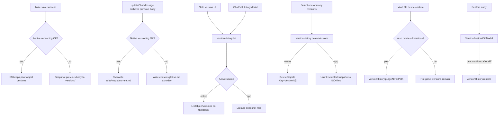

# 노트 + 채팅 수정 히스토리 — S3 네이티브 + 앱 관리 폴백

## 결론

**노트**와 **채팅 메시지 수정 이력** 모두 같은 정책이다. **수정 이력 관리(목록·미리보기·선택/개별/전체 버전 삭제·복원)** 를 이 레이어가 맡는다.

1. **S3 native** — 버킷 Object Versioning Enabled + IAM이면 `ListObjectVersions` / `GetObject(VersionId)` / `DeleteObject(VersionId)`.
2. **App-managed 폴백** — 버저닝 불가·비-S3면 vault에 스냅샷을 직접 쌓고, 파일 단위로 삭제한다.
3. **복원 게이트** — 목록에서 바로 덮어쓰지 않는다. **반드시 diff(현재 vs 선택 버전)를 본 뒤** 사용자가 확인해야 `restoreVersion` 실행.
4. **파일 삭제 시** — 노트(및 해당 path의 버전 대상)를 지울 때 **모든 버전도 함께 삭제할지** 묻는다(기본값·카피 아래).
5. **이력 UI** — 버전을 **체크 선택**해 해당 버전만 삭제하거나, 한 건/전부 삭제할 수 있다.

채팅은 이미 app 경로가 있다: [`.chat-with-myself/edits/<messageId>/<iso>.md`](src/utils/chatWithMyself/paths.js) + [`writeMessageEditVersion`](src/utils/chatWithMyself/storage.js) / [`ChatEditHistoryModal`](src/components/chatWithMyself/ChatEditHistoryModal.tsx)(삭제 UI 있음). 이번 작업에서 그 경로를 **폴백 전용**으로 두고, native가 되면 **메시지당 단일 키 overwrite**로 S3 버전에 맡긴다. 복원은 채팅에도 **diff 필수**를 추가한다(현재 모달은 삭제 위주).

일일 채팅 파일(`YYYY-MM-DD.md`) 전체에 대한 버전 UI는 하지 않는다. 메시지 단위 수정 이력만 다룬다(데이 파일 버전은 여러 메시지가 섞여 복원이 위험함).



## 현재 상태

- S3: [`s3Client.js`](src/utils/vault/s3Client.js) — Key-only. **VersionId 없음.** `deleteObject`도 Key만 → 버저닝 버킷에서는 delete marker만 생길 수 있음(특정 이력 영구 삭제 아님).
- 노트: 버전 UI/스냅샷 없음.
- 채팅: 수정 시 이전 body를 `writeMessageEditVersion`으로 항상 파일 아카이브. 레거시 inline `editHistory`도 모달에서 보조 표시. **엔트리/전체 삭제**는 [`ChatEditHistoryModal`](src/components/chatWithMyself/ChatEditHistoryModal.tsx)에 있음. **복원 + diff는 없음.**
- Diff 참고 구현: [`NoteContentConflictModal`](src/components/shared/modals/NoteContentConflictModal.tsx) — `@git-diff-view/react` + `@git-diff-view/file` Split view(동적 import).

## 공유: 지원 판별

Vault/S3 스코프당 한 번 probe → 캐시(`native` | `app` | `off`).

| 조건 | 내용 |
|------|------|
| 버킷 | Object Versioning = **Enabled** |
| IAM (읽기) | `s3:ListBucketVersions`, `s3:GetObjectVersion` |
| IAM (삭제) | `s3:DeleteObjectVersion` (특정 VersionId 영구 삭제에 필요; `s3:DeleteObject`만으로는 부족할 수 있음) |
| 실패 | AccessDenied / NotImplemented / 비-S3 → **app** |

노트·채팅이 **같은 probe 결과**를 쓴다. 삭제가 Deny여도 list/get가 되면 `native`로 두고, 삭제 시에만 에러 → 사용자에게 IAM 안내(또는 delete capability를 probe에 `canDelete`로 분리해도 됨 — **MVP: 삭제 시도 시 실패 메시지**).

## 경로 A — S3 native

### 노트

- 대상 Key = 노트 path. Put만으로 버전 축적.
- 목록/미리보기 = `ListObjectVersions` + `GetObject(VersionId)`.
- **선택/개별 버전 삭제** = `DeleteObject` / `DeleteObjects` with **VersionId** — 고른 버전만 영구 제거. **VersionId 없이 Key만 지우면 안 됨**(delete marker → 현재 객체만 “삭제된 것처럼” 보이고 이력은 남음).
- **현재(IsLatest) 버전**은 이력 UI의 “버전만 삭제” 대상에서 제외(파일 삭제가 아닌 한 현재 본문 보호). noncurrent / 과거 VersionId만 선택·삭제.
- **파일 삭제 + 버전 전부 purge** = `ListObjectVersions`로 해당 Key의 **모든 VersionId(+ delete marker)** 를 모아 `DeleteObjects`로 제거. 사용자가 “버전 함께 삭제”를 켠 경우에만.
- 복원 = diff 확인 후 선택 VersionId 본문을 현재 path에 Put(복원 전 상태가 새 버전으로 남음).
- native 활성 시 `.versions/` 스냅샷 **안 남김**.

### 채팅 수정

메시지는 day 파일 안에 있으므로, **수정 아카이브용 전용 Key**가 필요하다.

- **Canonical key (native):** `.chat-with-myself/edits/<messageId>/current.md`
- 수정 시 이전 body를 `serializeEditVersion(...)`으로 직렬화한 뒤 **같은 Key에 overwrite** (`putTextOverwrite`).
- S3가 이전 `VersionId`를 보관 → 목록은 `ListObjectVersions(Prefix=exact key)` (또는 Key 일치 필터).
- **선택/개별/전부 버전 삭제** = `DeleteObjects`에 `{Key: current.md, VersionId}[]`. UI에서 체크한 항목만 또는 “전부 삭제”.
- **복원**: 선택한 VersionId 본문 parse → **diff(현재 메시지 body vs 선택 버전)** → 확인 후 `updateChatMessage`로 반영(이때 overwrite 하면 복원 전 상태가 새 버전으로 남음).
- **타임스탬프별 새 파일은 만들지 않음** (객체 폭증 방지; 버전은 S3가 담당).
- 채팅 **메시지 삭제**와 버전 purge는 별도(메시지 삭제 confirm에 “수정 이력도 삭제” 옵션을 둘 수 있음 — **MVP: 메시지 삭제 시 edits/ 이력도 함께 지울지 묻기**, 노트 파일 삭제와 같은 UX).

기존에 쌓인 `edits/<messageId>/<iso>.md`는 기본적으로 삭제하지 않는다. 목록 시 native 버전 뒤에 **레거시 app 파일을 이어서** 보여 연속성을 유지한다. 레거시 파일은 선택 삭제·전부 삭제·메시지 purge 시 unlink.

## 경로 B — App-managed 폴백

### 노트 (신규)

```text
.versions/
  <entryId>/
    meta.json    # { path, createdAt, size, contentHash, source: "app" }
    body.md
```

- 저장 성공 + content hash 변경 시에만.
- 대상: Create-file 문서 등 사용자 노트. 제외: `.trash/`, `.versions/`, `.settings/`, `.chat-with-myself/**`, 대용량 바이너리.
- 파일당 최대 **20**개; Settings 토글 + AS settings toggle.
- **선택/개별 삭제** = 체크한 `entryId/`만 제거.
- **경로 전체 purge** = 해당 노트 path에 묶인 `.versions/` 엔트리 전부 제거(파일 삭제 confirm에서 “버전 함께 삭제” 시).
- **복원** = diff 확인 후 현재 path에 본문 쓰기; 복원 직전 현재 본문 한 번 스냅샷.

### 채팅 (기존 유지)

- native 불가 시 **현재 동작 그대로**: `messageEditVersionKey` → `edits/<messageId>/<iso>.md`.
- `loadMessageEditHistoryPage` / 레거시 inline `editHistory` 병합 로직 유지 + **삭제**는 기존 `onDeleteHistoryEntry` / `onDeleteAllHistory`를 공통 `delete`로 래핑.
- **복원** 추가 시에도 동일하게 diff 게이트 필수.
- 별도 `.versions/`로 옮기지 않음(채팅 전용 경로 유지).

## 공통 레이어

`src/utils/versionHistory/`

- `types.ts` — `VersionEntry { id, source: 's3-native' | 'app' | 'legacy-app', at, size, isLatest?, … }`
- `resolveSource()` — vault probe 캐시
- 타깃 종류:
  - `note`: vault-relative path
  - `chatEdit`: messageId → native면 `…/current.md`, app면 folder prefix
- `listVersions` / `readVersion` / **`deleteVersions(ids[])`** / **`purgeAllForTarget`** / `restoreVersion`
- 어댑터: `s3NativeAdapter.ts`, `appManagedNoteAdapter.ts`, `chatEditAdapter.ts` (기존 storage 헬퍼 래핑)

### 삭제 계약

| API | 용도 |
|-----|------|
| `deleteVersions(target, entryIds[])` | 이력 UI에서 **고른 버전만** 삭제(1개·다중 동일). |
| `purgeAllForTarget(target)` | 해당 path/message의 **모든 과거 버전**(+ native면 noncurrent VersionId·delete marker 정리). 파일/메시지 삭제 confirm의 “버전 함께 삭제” 또는 이력 “전부 삭제”. |

| source | 동작 |
|--------|------|
| `s3-native` | `DeleteObjects` with **VersionId 필수**. 이력 UI에서 IsLatest는 선택 불가. `purgeAllForTarget`은 list 후 VersionId 전부(파일 삭제와 함께일 때는 IsLatest 포함해 Key를 완전히 지움). |
| `app` / `legacy-app` | 선택 id만 unlink / 전부 unlink. 레거시 inline `editHistory`는 기존 정리 로직 유지. |

삭제 실패(권한 등) 시 부분 성공 목록을 반환하고 UI에 표시.

### 파일(노트) 삭제 confirm — 버전 함께 삭제

[`DeleteConfirmModal`](src/components/shared/modals/DeleteConfirmModal.tsx)에 녹음용 `deleteWithRecordings`와 같은 패턴으로 **`deleteWithVersions`** 옵션을 추가한다.

| 항목 | 내용 |
|------|------|
| 표시 조건 | 대상이 버전 관리 대상 노트이고, probe/캐시상 버전이 있을 수 **있거나** native/app 버저닝이 켜져 있을 때(목록 probe 비용이 크면 “버전 기록이 켜져 있으면 옵션 표시”로 MVP 단순화) |
| 카피 | 예: `이전 버전도 함께 삭제` — 끄면 파일(또는 휴지통 이동)만 하고 S3/앱 이력은 남김 |
| 기본값 | **켜짐(true)** — 스토리지 누수 방지. 사용자가 의도적으로 끄면 이력만 orphan으로 남을 수 있음(문서에 명시) |
| 적용 시점 | **영구 삭제**(휴지통에서 삭제 / 휴지통 미사용 즉시 삭제). 휴지통 **이동만** 할 때는 버전을 지우지 않음(복원 가능해야 함). 휴지통 비우기/영구 삭제 시 다시 묻거나, 이동 시 남긴 버전을 purge 옵션과 함께 처리 — **MVP: 영구 삭제 confirm에서만 `deleteWithVersions`** |
| 실행 | `onConfirm({ deleteWithVersions })` → 트리 삭제 훅에서 path별 `purgeAllForTarget({ kind: 'note', path })` |

폴더 삭제 시: 하위 버전 대상 파일마다 purge(또는 prefix 단위 best-effort). 실패는 로그+토스트, 파일 삭제는 계속.

### 복원 계약 (diff 필수)

```text
list → user picks entry → readVersion + load current body
     → VersionRestoreDiffModal (Split: 현재 | 선택 버전)
     → user confirms → restoreVersion
```

- **금지**: 목록/컨텍스트 메뉴에서 ConfirmModal만으로 즉시 복원.
- 공유 UI: `VersionRestoreDiffModal` — [`NoteContentConflictModal`](src/components/shared/modals/NoteContentConflictModal.tsx)과 같이 `@git-diff-view/*` 동적 import, sticky header/footer, nested z ≥ parent.
- 라벨 예: 왼쪽 `현재`, 오른쪽 `선택한 버전 (일시)`.
- 노트·채팅 **동일 컴포넌트**; 채팅은 메시지 body 문자열 기준.
- `restoreVersion` API는 UI 밖에서 호출될 수 있으므로, **제품 UI 경로는 반드시 diff를 거치도록** 문서/리뷰 체크. (내부 테스트 헬퍼만 직접 restore 허용.)

채팅 쓰기 경로 변경점:

- [`updateChatMessage`](src/utils/chatWithMyself/storage.js) → `writeMessageEditVersion` 대신 `versionHistory.archiveChatEdit(ctx, messageId, archived)` 호출.
- native: `current.md` overwrite.
- app: 기존 ISO 파일 write.

## UI

| 표면 | 동작 |
|------|------|
| 노트 버전 모달 | 사이드바/에디터 메뉴 + AS. 행 **체크박스 다중 선택** → 툴바 **선택 삭제**; 단건 컨텍스트 **삭제**; **전부 삭제**; 단건 **복원(→ diff)**; 미리보기 |
| 채팅 | [`ChatEditHistoryModal`](src/components/chatWithMyself/ChatEditHistoryModal.tsx)에 동일: 다중 선택 삭제(기존 단건/전부 삭제 유지) + **복원 → VersionRestoreDiffModal**. 소스 배지 optional (`S3` / `앱`) |
| 파일 삭제 | [`DeleteConfirmModal`](src/components/shared/modals/DeleteConfirmModal.tsx) — `deleteWithVersions` 체크(녹음 옵션과 나란히) |
| 메시지 삭제 | MVP: “수정 이력도 삭제” 체크 → `purgeAllForTarget({ kind: 'chatEdit', messageId })` |
| Settings | 앱 버전 기록 on/off·노트 보존 개수; **MVP: master “버전 기록” 토글이 노트 app + 채팅 app 아카이브를 함께 끔; native는 버킷 설정에 따름** |

버전 모달 선택 삭제 UX:

- 체크한 항목만 `deleteVersions` — ConfirmModal danger(`선택한 N개 버전 삭제`).
- “전부 삭제”는 `purgeAllForTarget`(현재 IsLatest 제외한 이력만; 파일 자체는 유지).
- Shift로 confirm 스킵은 채팅 기존 패턴을 노트에도 선택 적용 가능.

모달: sticky header/footer, nested z-index, 버튼 아이콘, 삭제는 `ConfirmModal variant="danger"`. 복원 confirm은 **diff 모달 footer**에서만.

## 주의할 부작용

- **비용** — native 채팅은 메시지마다 `current.md` 버전이 쌓임. 수정이 잦은 메시지 lifecycle·수동 삭제 권장. app 채팅은 파일 수 증가(현행과 동일).
- **이중 기록 금지** — native일 때 ISO 파일을 추가로 쓰지 않음. 레거시 ISO는 읽기(+삭제)만.
- **Delete vs delete marker** — 이력 정리 시 반드시 VersionId. Key-only delete는 버전 히스토리 관리 API에 쓰지 않음.
- **현재 버전 보호** — 이력 UI에서 IsLatest는 선택·단건 삭제 비활성. **파일 영구 삭제 + deleteWithVersions** 일 때만 IsLatest 포함 purge.
- **orphan 버전** — 파일만 지우고 버전 유지 시 스토리지에 이력만 남을 수 있음. Settings/문서에 “버전만 남은 경우” 안내; 추후 orphan GC는 비범위(MVP 아님).
- **데이 파일** — 노트 버전/스냅샷 대상에서 `.chat-with-myself/*.md` day 파일 제외(메시지 수정 이력과 분리).
- **custom markdown docs** — `chat-edit-version` 문법 변경 없으면 docs 갱신 최소; native 키 규약·파일삭제 purge·선택 삭제·복원 diff 정책 문서화.
- **충돌/동기화** — 기존 ETag/LastModified 유지. 복원 Put도 동일 경로.

## 구현 순서 (승인 후)

1. probe/캐시 + `versionHistory` 타입·native 어댑터(list/get/**deleteVersions**/**purgeAllForTarget**)
2. `VersionRestoreDiffModal` (git-diff-view) — 복원 게이트
3. 채팅 hybrid + `ChatEditHistoryModal` 다중 선택 삭제·전부 삭제·diff 복원
4. 노트 `.versions/` app 어댑터 + 저장 훅 + 선택/전체 삭제
5. 노트 버전 UI·AS·settings toggle
6. `DeleteConfirmModal` `deleteWithVersions` + 영구 삭제 훅 연동(메시지 삭제 옵션 포함)
7. 트리/검색에서 `.versions` 제외 + IAM/키 규약 문서

## 범위

계획 단계. 코드 구현은 별도 실행 지시 후.
