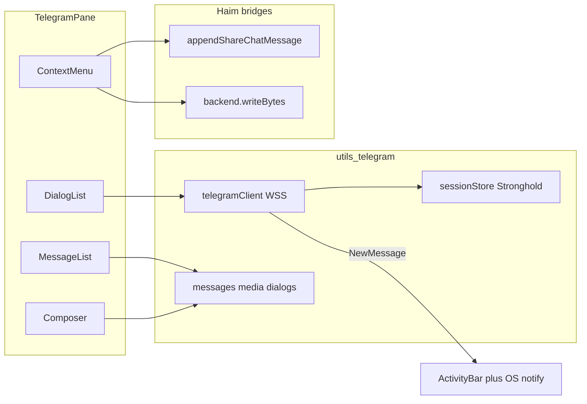

# Telegram (GramJS) messenger — Tauri desktop + Android

## Decisions (locked)

- **Platform**: Tauri desktop **and** Tauri Android (`isTauriDesktopPlatform() || isTauriAndroid()`). Web builds show settings copy + `/telegram` gate (“데스크톱 또는 Android 앱에서만 사용 가능”); no MTProto client on web. iOS stays gated even if `isDesktopApp()` is true there.
- **Transport**: Both shells are WebViews without Node `net` / `tls`. Always `useWSS: true` and `networkSocket: PromisedWebSockets`. Do not rely on GramJS auto-detect: a global `process` / `buffer` polyfill can select `PromisedNetSockets` and fail on Android (and desktop WebView).
- **Credentials**: User enters `api_id` / `api_hash` from [my.telegram.org](https://my.telegram.org); phone + code (+ 2FA) login via GramJS `client.start`.
- **Session**: Stronghold via [`desktopStrongholdSecrets.ts`](src/utils/shared/desktopStrongholdSecrets.ts). `isDesktopApp()` is already true on Android, and Android Argon2 mem_cost is already lowered in [`stronghold_kdf.rs`](src-tauri/src/stronghold_kdf.rs). Same store on both shells; logout clears it.
- **UI surface**: Separate quasi-page `/telegram` (not merged into 「나와의 채팅」), lazy-loaded like chat. Desktop: list | thread. Android (and narrow): one pane, list → thread, system/back returns to the list.
- **Live updates**: While the WebView JS context is running. Android activity stop suspends the socket; reconnect on resume. No foreground service, no FCM, no background MTProto.
- **Haim bridges**: Context menu → share into Chat-with-Myself; context menu → download media into vault Tree folder (Android local vault `writeBytes` included).

## Architecture

### Client layer — `src/utils/telegram/`

| Module | Role |
|--------|------|
| `telegramPlatform.ts` | `isTelegramShell()` = `isTauriDesktopPlatform() \|\| isTauriAndroid()` |
| `telegramClient.ts` | Singleton `TelegramClient`: connect / disconnect / reconnect only when `isTelegramShell()`. Options: `useWSS: true`, `networkSocket: PromisedWebSockets`, `connectionRetries`. On Android `resume` / `visibilitychange`, reconnect if the socket dropped. |
| `sessionStore.ts` | Persist `apiId`, `apiHash`, `StringSession` via Stronghold; clear on logout. Never `localStorage`. |
| `dialogs.ts` | `getDialogs` → chat list model |
| `messages.ts` | History (`getMessages` + pagination), send, reply (`replyTo`), forward (`forwardMessages`) |
| `media.ts` | Send file/photo from `File` / `Uint8Array` (WebView file input). `downloadMedia` → `Uint8Array` / `Blob`. Android `content://` only if the picker does not already yield a `File`. |
| `chats.ts` | Create group / channel via GramJS TL helpers |
| `events.ts` | `NewMessage` → in-app activity + unread. OS notify only while JS is alive (see Notifications). |
| `shareToChat.ts` | Map Telegram text/media → [`appendShareChatMessage`](src/utils/chatWithMyself/shareSend.js) |
| `saveToVault.ts` | Download media buffer → `createStorageBackend(...).writeBytes(destPath)` after folder pick. Android local vault uses the same `writeBytes` path as desktop local vault. |

Depend on npm `telegram` (GramJS). Dynamic `import('telegram')` only from Telegram modules so cold start stays lean. Android APK uses the same `build:tauri` frontend dist; do not add a second bundle.

### Vite / bundle

- Lazy route only; add `vendor-telegram` in [`vite.config.ts`](vite.config.ts) `manualChunks` for `/node_modules/telegram/`.
- Polyfill `buffer` for GramJS binary helpers. Do **not** set a global `process.versions.node` (or otherwise impersonate Node) or the client will try TCP sockets inside Android System WebView.
- CSP is already `null` in [`tauri.conf.json`](src-tauri/tauri.conf.json). `INTERNET` is already in [`AndroidManifest.xml`](src-tauri/gen/android/app/src/main/AndroidManifest.xml). WSS does not need cleartext.

### UI — `src/components/telegram/`

- `TelegramPane.tsx` — desktop: dialog list | thread | composer. Android / narrow: stack (list **or** thread). Thread header has back to the list.
- `TelegramLoginModal.tsx` — api credentials (if missing), phone, code, 2FA (modal sticky chrome)
- `TelegramDialogList.tsx` — chats + unread
- `TelegramMessageList.tsx` — history + load older
- `TelegramComposer.tsx` — text, attach, reply chip
- `TelegramMessageContextMenu.tsx` — AdaptiveContextMenu / MobileContextMenuModal (Android portrait uses the full-screen modal):
  - 답장
  - 다른 채팅으로 전달
  - **나와의 채팅으로 공유**
  - **Vault Tree에 저장** (media/docs)
- `TelegramForwardModal.tsx` — pick dialog → `forwardMessages`
- `TelegramCreateChatModal.tsx` — create group / channel (title + type)
- `TelegramSaveToVaultModal.tsx` — folder picker patterned on [`KanbanFolderPickerModal.tsx`](src/components/kanban/KanbanFolderPickerModal.tsx) + `saveToVault`
- `TelegramShellGate.tsx` — web (and non-Android mobile) placeholder

Long-press → `vibrateLongPressAction()` (`VIBRATE` is already granted). Nested portals `z-100010+`.

### Notifications

| Shell | Behavior |
|-------|----------|
| Both | In-app `ActivityIndicator` + unread while the route is not focused and the app process is alive |
| Desktop | Web `Notification` when `document.hidden` |
| Android | [`tauri-plugin-notification`](https://v2.tauri.app/plugin/notification/) while the activity’s JS is still running. Android 13+: `POST_NOTIFICATIONS` runtime permission. Web `Notification` in System WebView is not the system tray. |

When Android `onPause` freezes the WebView, the MTProto socket stops. Reconnect when the activity resumes. Do not add a foreground service to keep GramJS alive in the background.

### App wiring

- Path `/telegram` + workspace tab `TELEGRAM_TAB_ID` in [`workspaceTabs/types.ts`](src/utils/workspaceTabs/types.ts)
- Lazy mount in [`WorkspaceMainPanels.tsx`](src/components/shell/workspace/WorkspaceMainPanels.tsx)
- Sidebar 「Telegram」 when `isTelegramShell()` (desktop and Android, not web)
- [`routeEntries.ts`](src/pages/routeEntries.ts): `FEATURE_QUASI_PAGES`
- Settings `integrations` → `settings-telegram` in [`settingsPageCatalog.ts`](src/utils/settingsPageCatalog.ts): api_id/hash, connect/logout; web shows the shell-only note
- Advanced Search: `telegram-open` (+ composer focus when mounted)
- `ActivityTypes.TELEGRAM_*` in [`ActivityIndicatorContext.tsx`](src/contexts/ActivityIndicatorContext.tsx)
- Android manifest: `POST_NOTIFICATIONS` only if the notification plugin is added. No extra network security config for `wss://`.

### Feature map

| Requirement | Implementation |
|-------------|----------------|
| Chat forward | `forwardMessages` + Forward modal |
| Send/receive | `sendMessage` + `NewMessage` over WSS |
| Notifications | Desktop Web Notification; Android plugin notification; both get ActivityIndicator + unread. No background delivery on Android. |
| History | `getMessages` pagination |
| File send | Composer `sendFile` from `File` bytes |
| File download | Vault save primary via `downloadMedia` → bytes; optional OS download secondary |
| Group / channel create | Create modal |
| Reply | Composer `replyTo` + menu |
| Share to Chat-with-Myself | Menu → media as File(s) + text → `appendShareChatMessage` |
| Save to Tree | Menu → folder picker → `writeBytes` → tree refresh (Android local vault included) |
| Android layout | Single pane + mobile context menu + reconnect on resume |

### Security

- Never log api_hash or session string.
- Session only in Stronghold; logout wipes it.
- Settings note: user-owned API credentials + Telegram terms.
- No server MTProto proxy. No embedded api_id/api_hash in the APK.

### Out of scope

- Web GramJS connection
- iOS shell
- Background MTProto, foreground service, FCM
- Multi-account, calls/stories/stickers deep UX, auto-mirroring all Telegram history into vault day-files

## Implementation order

1. Deps + Vite chunk/polyfill (no Node impersonation) + sessionStore + telegramClient (`useWSS` + `PromisedWebSockets`) connect/login/logout on desktop and Android
2. Settings + shell gate + `/telegram` shell + sidebar/tab/AS (`isTelegramShell()`)
3. Dialogs + history + send + reply; Android single-pane navigation
4. NewMessage + in-app unread; desktop Web Notification; Android `tauri-plugin-notification` + `POST_NOTIFICATIONS`; reconnect on Android resume
5. File send/download + forward + create group/channel
6. Context menu bridges: Chat-with-Myself share + Vault Tree save (including Android local vault)
7. Activity bar, empty/error states, disconnect on app logout
